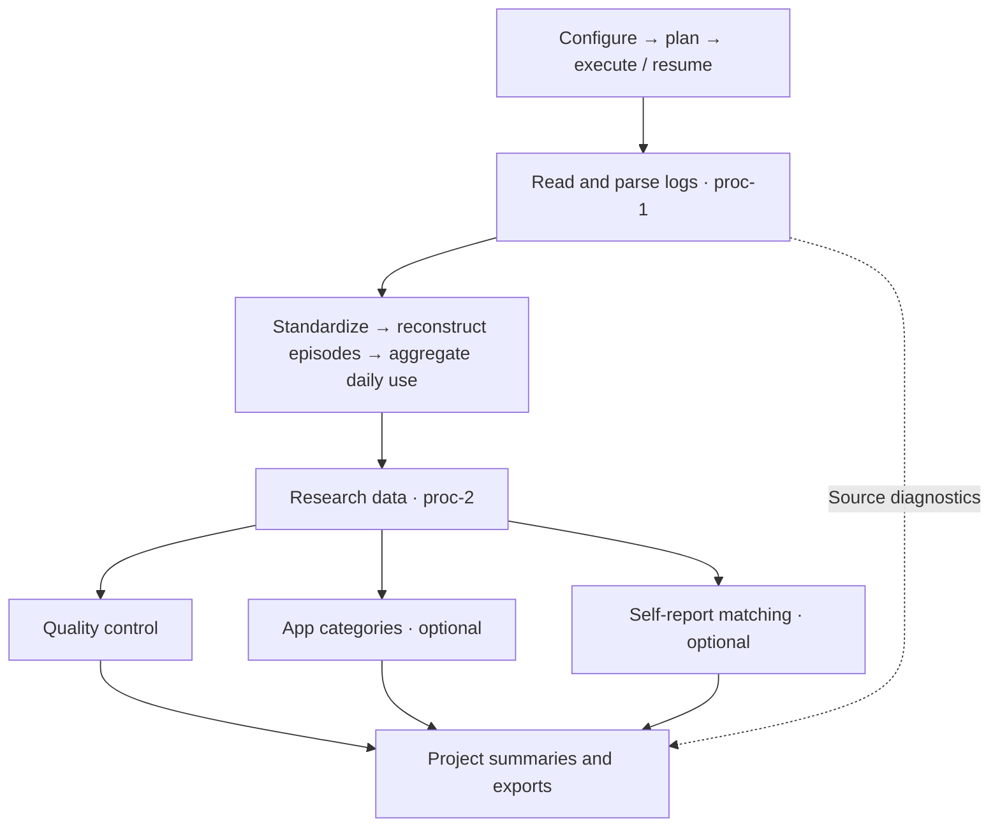

# appusageR 

appusageR turns Android text exports from APP Usage / Screen Time into structured
data for behavioral and mobile-sensing research. It parses logs, reconstructs
usage episodes, summarizes daily app use, evaluates data quality, adds app
categories, and links sources to self-report records.

Use individual functions with R objects or run a project workflow with parallel
file processing, validated caches, checkpoints, and recovery from interruptions.

**Package:** 0.3.11 · **App dictionary:** 2.0.0 · **Scientific schema:** 0.3.5

<br clear="right" />

## Installation

Requires R 4.1.0 or later. Install from GitHub:

```r
install.packages("remotes")
remotes::install_github("fenmeng123/appusageR")
library(appusageR)
```

## Run a project

Set the input paths, output directory, and study timezone, then inspect and run
the workflow plan:

```r
sources <- data.frame(
  source_file = c("raw/a.txt", "raw/b.txt"),
  participant_id = c("p001", "p002")
)
config <- appusage_config(time = list(tz = "Asia/Shanghai"))
plan <- plan_appusage_workflow(sources, "outputs/study", config)
print(plan)
result <- run_appusage_workflow(plan = plan)
summary(result)

# Resume using the saved manifest and configuration.
result <- run_appusage_workflow(project_dir = "outputs/study")
```

The plan lists source and project stages, planned actions, and their reasons.
Execution checks inputs and cache contents before reusing completed stages.
`run_appusage_stage()` runs `parse`, `research_data`, `qc`, `category`, `matching`,
or `summary` independently.



## Processing modules

| Module | Output | Main functions |
|---|---|---|
| Text input | Decoded text and detected export format | `read_appusage_text()`, `detect_appusage_type()` |
| Parsing | Native line, meta, day, or app records and source diagnostics | `parse_line()`, `parse_meta()`, `parse_day()`, `parse_app()` |
| Standardization | Common columns, app identities, and millisecond durations | `standardize_appusage()` |
| Episode reconstruction | Paired meta events and a foreground timeline with duration audit fields | `reconstruct_meta_episodes()` |
| Daily aggregation | App use by local calendar date | `build_appusage_daily()` |
| Quality control | Coverage, anomaly flags, and eligibility by data grain | `assess_appusage_qc()`, `qc_appusage_anomalies()` |
| App categories | Level 1/Level 2 labels and matching diagnostics | `add_app_categories()`, `update_app_categories_cache()` |
| Self-report matching | Questionnaire rows linked to source records | `match_appusage_self_report()` |

`run_first_level_appusage()` combines text input and parsing;
`run_second_level_appusage()` combines standardization, reconstruction, and daily
aggregation. `read_appusage_batch()` processes a collection of source files.

Episodes are split at local midnight in the configured timezone. Meta daily
values use the native summary by default; `meta_daily_source = "episodes"` selects
episode-derived values, and `"both"` retains the two sources as labeled rows.
QC reports distinguish execution status, quality findings, and eligibility for
each event, episode, or daily table.

## App categories

The optional category module uses the bundled dictionary by default and accepts
a custom dictionary. Package names take precedence. Exact app names resolve
conflicting candidates within a package and provide a fallback when a package
name is absent from the dictionary. Unresolved candidates retain a pending
review status.

Enable categories in a project configuration, or update existing proc-2 caches:

```r
config <- appusage_config(category = list(enabled = TRUE))

# Annotate research data held in memory.
categorized <- add_app_categories(research_data)

# Refresh paired RDA/JSON caches in a project or a flat export directory.
updated <- update_app_categories_cache(rda_paths)
```

Here, `research_data` is a processed R object and `rda_paths` lists its saved
proc-2 files. Category updates preserve scientific tables and source relationships.
`overwrite = FALSE` preserves complete existing labels. Unchanged, integrity-checked
RDA/JSON pairs are reused.

### Bundled dictionary

`app_category_dictionary` 2.0.0 contains **28,088 rows** and five character columns:
`App_Name`, `App_Name_Repaired`, `App_UUID`, `Level_1_Category`, and
`Level_2_Category`. Categories describe application functions. The vocabulary
includes 14 functional Level 1 categories, 31 functional Level 2 categories, and
the provisional pair `Others / Unclassified` for identities awaiting classification.

The dataset combines 11,849 original dictionary rows with 16,239 app-name and
alias rows covering 14,118 additional identities. Of these additional identities,
1,925 have author-approved functional labels and 12,193 carry provisional
`Others / Unclassified` labels. Version and source hashes are stored in the
`dictionary_provenance` attribute.

```r
data("app_category_dictionary", package = "appusageR")
head(app_category_dictionary)
attr(app_category_dictionary, "dictionary_provenance")$dictionary_version
```

Dictionary versions follow independent `MAJOR.MINOR.PATCH` rules: PATCH corrects
existing identities, MINOR adds new identities, and MAJOR changes the taxonomy.
See the [dictionary version policy](inst/DICTIONARY_VERSIONING.md) and
[copyright and contributor record](inst/COPYRIGHTS).

### Prioritize dictionary additions

`profile_uncoded_apps(manifest)` profiles unknown apps using explicit `source_id`,
`person_id`, `observation_id`, `selected_primary`, and `rda_path` fields. It measures
foreground use from one canonical table per primary file, takes each person's
maximum share across observations, and counts distinct people with positive use.

The default policy prioritizes an app when **any person's maximum share is at least
5%**, or **its prevalence among people with measurable positive foreground use is
at least 1%**. Measured unknown apps below both thresholds receive
`Others / Unclassified` when the profile is supplied to the category update.
Missing measurements, apps found exclusively in alternative files, and conflicting
matches retain explicit pending statuses. These are dictionary-maintenance
priorities; QC and eligibility follow their own configured rules.

Use `appusage_category_policy()` to configure the policy and
`extract_uncoded_apps()` to collect identities for dictionary maintenance.

## Project collections and self-report matching

`run_appusage_projects(projects, batch_dir, workers = 8)` processes projects in
registry order with parallel file workers inside each project. Each registry row
provides `project_id`, `project_name`, `project_dir`, and `output_dir`; optional
questionnaire columns configure matching. Project checkpoints retain outcomes
and support recovery of unfinished stages.

`match_appusage_self_report()` links questionnaire rows through sequence IDs and
uploaded filenames, resolving multiple candidates by export type and timestamp.
Matched and unmatched questionnaire rows are retained.
`run_appusage_project_workflow()` adapts Wenjuanxing project folders and workbooks
to this workflow and writes matched Excel output.

## Caches, summaries, and delivery checks

Each source has paired RDA/JSON files at two cache levels: parsed records in
`proc-1`, and typed event, episode, and daily tables in `proc-2`. Metadata records
source identity, processing stages, QC, and categories.

- `validate_appusage_project(project_dir, verify = "content")` checks source
  identities, signatures, table types, links, and questionnaire exports.
- `verify = "metadata"` previews saved validation evidence.
- `run_appusage_stage("summary", project_dir)` refreshes project summaries and
  enabled matching exports from valid caches.
- `rebuild_first_level_summary_from_cache()` rebuilds the first-level summary.
- `print()` and `summary()` provide compact views of plans and workflow results.

See the [workflow guide](vignettes/appusageR-workflow.Rmd) for configuration and
examples, [NEWS](NEWS.md) for changes, and
[GitHub Issues](https://github.com/fenmeng123/appusageR/issues) for bug reports.

Author: Kunru Song · <Kunrusong97@gmail.com>

License: [GPL-3](https://www.gnu.org/licenses/gpl-3.0.html)
