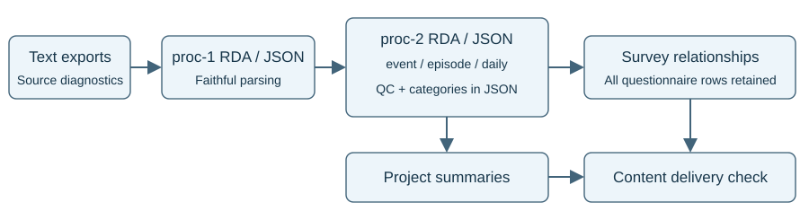

# appusageR 

appusageR turns Android text exports from APP Usage / Screen Time into structured
data for behavioral and mobile-sensing research. It parses logs, reconstructs
episodes, summarizes daily app use, evaluates quality, adds application categories
and links sources to self-report records.

**Package:** 0.3.11 · **App dictionary:** 2.0.0 · **Scientific schema:** 0.3.5

<br clear="right" />

## Install and explore

Requires R 4.1.0 or later. To install from GitHub with the tutorials:

```r
install.packages(c("remotes", "knitr", "rmarkdown"))
remotes::install_github("fenmeng123/appusageR", build_vignettes = TRUE)
library(appusageR)
help("appusageR")
```

Building the HTML tutorials requires Pandoc, which RStudio supplies. To install
only the package and function help, omit `build_vignettes = TRUE`; the tutorial
sources linked below remain available on GitHub.

Load the shared fictional data and inspect one source:

```r
data(appusage_demo)
record <- appusage_demo$records$mixed_line_meta
head(record$data$daily[, c("date", "app_name", "duration_ms")])
qc <- assess_appusage_qc(record, metadata = record$metadata, participant_id = "105")
qc$qc[c("pass_qc", "analysis_eligible_daily")]
```

`?appusage_demo` describes ten standardized records, a 15-upload inventory and a
17-row questionnaire. All apps, identities and responses are fictional. The
[scenario guide](inst/extdata/synth/README.md) supplies expected counts and totals.

## Choose a task

All six tutorials execute their core code with the same installed synthetic
data. File-writing steps use temporary directories and one worker.

| Task | Tutorial source | Installed command |
|---|---|---|
| 1. Read, preprocess, run QC and inspect results | [Start a project](vignettes/appusageR-workflow.Rmd) | `vignette("appusageR-workflow", package = "appusageR")` |
| 2. Compare pure and mixed formats | [Formats and data model](vignettes/formats-and-data-model.Rmd) | `vignette("formats-and-data-model", package = "appusageR")` |
| 3. Explain QC, blank days and overlapping time | [QC and audits](vignettes/day-and-overlap-audits.Rmd) | `vignette("day-and-overlap-audits", package = "appusageR")` |
| 4. Reuse, diagnose and repair temporary caches | [Cache recovery](vignettes/caches-and-recovery.Rmd) | `vignette("caches-and-recovery", package = "appusageR")` |
| 5. Resolve category conflicts and update labels | [Categories and dictionary](vignettes/categories-and-dictionary.Rmd) | `vignette("categories-and-dictionary", package = "appusageR")` |
| 6. Run two projects and retain survey rows | [Projects and surveys](vignettes/projects-and-surveys.Rmd) | `vignette("projects-and-surveys", package = "appusageR")` |

The last tutorial includes an all-failure project with five preserved input
diagnoses. The category tutorial distinguishes resolved labels, unresolved
conflicts, provisional residuals and insufficient statistics.

All 61 public functions have runnable Examples. The
[configuration reference](man/appusage_configuration.Rd) (`?appusage_configuration`)
lists the 46 workflow settings and five category-policy arguments, including
defaults, units, valid choices and affected stages.

## Run the complete synthetic project

```r
demo("synthetic-project", package = "appusageR", ask = FALSE)
summary(demo_result)
demo_result$matched_self_report[, c("survey_id", "moSens_match_status")]
```

The demo processes 15 uploads with two file workers, evaluates QC and retains all
17 survey rows. Inspect `demo_output`, then remove that temporary directory with
`unlink(demo_output, recursive = TRUE)`. See `?appusage_synthetic_project` for a
serial alternative and the original single-day example.

## Data flow



Every source has paired proc-1 and proc-2 RDA/JSON caches. Proc-2 contains typed
event, episode and daily tables; milliseconds are the numeric duration unit.
QC and categories are recorded in proc-2 JSON. Unavailable grains are typed empty
tables. Project delivery, source execution, QC pass and grain eligibility use
separate denominators.

`run_appusage_workflow()` plans and resumes a project. `run_appusage_projects()`
runs an explicit registry in order, with file workers inside each project.
`run_appusage_project_workflow()` adds the Wenjuanxing folder/workbook adapter.
`match_appusage_self_report()` preserves every questionnaire row and links by
upload sequence and filename. `validate_appusage_project(verify = "content")`
checks required outputs and diagnosed source failures.

## Manual application dictionary

The bundled `app_category_dictionary` **2.0.0** contains **28,088 rows** and five
character columns: `App_Name`, `App_Name_Repaired`, `App_UUID`, `Level_1_Category`
and `Level_2_Category`. It has 14 functional L1 categories, 31 functional L2
categories, and the provisional pair `Others / Unclassified`.

The dictionary retains 11,849 parent rows. Another 16,239 app-name/alias rows
cover 14,118 added identities: 1,925 have author-approved functional labels and
12,193 have provisional residual labels. Residuals indicate pending
classification, not measured low use or completed independent review.

```r
data(app_category_dictionary)
attr(app_category_dictionary, "dictionary_provenance")$dictionary_version
```

Package names take priority; exact names can resolve candidates within a package
or provide an unambiguous fallback. Unresolved conflicts remain pending.
`update_app_categories_cache()` updates existing proc-2 pairs independently.
`profile_uncoded_apps()` uses explicit people and selected primary files to
prioritize dictionary additions. See tutorial 5 for thresholds and denominators.

Dictionary versions follow independent `MAJOR.MINOR.PATCH` rules: PATCH corrects
existing identities, MINOR adds new identities, and MAJOR changes the taxonomy.
See the [dictionary version policy](inst/DICTIONARY_VERSIONING.md) and
[copyright and contributor record](inst/COPYRIGHTS).

[NEWS](NEWS.md) · [Report an issue](https://github.com/fenmeng123/appusageR/issues)

Author: Kunru Song · <Kunrusong97@gmail.com> · License: [GPL-3](https://www.r-project.org/Licenses/GPL-3)
